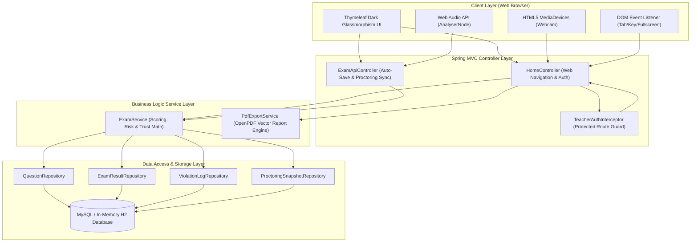
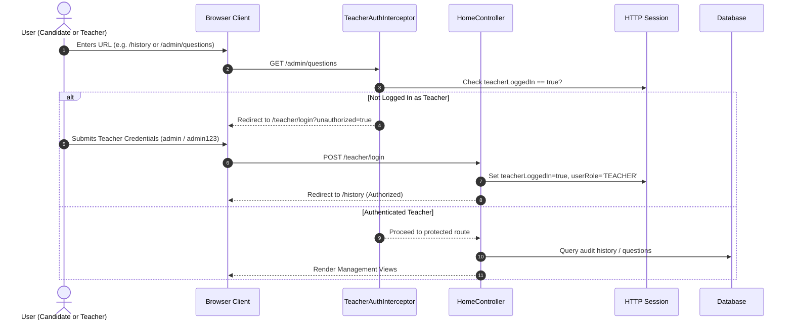
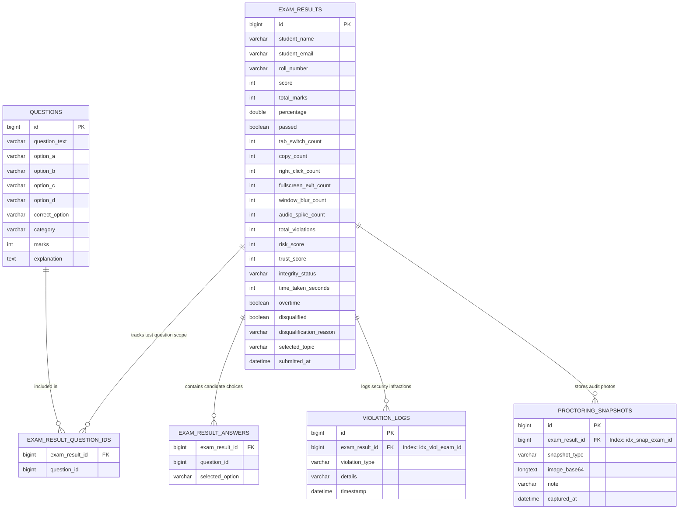
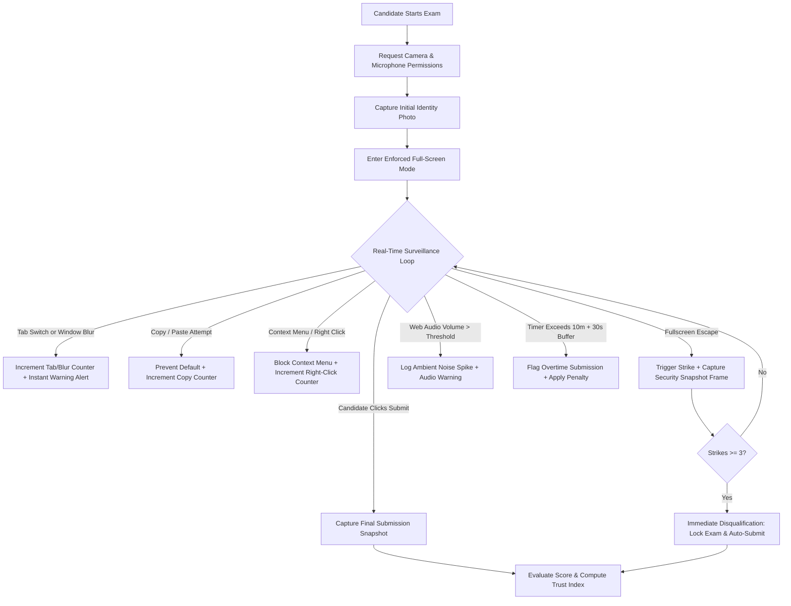

# 🏛️ SecureExam — Comprehensive System Architecture & Engineering Documentation

This document provides complete architectural, database schema, security, role separation, and proctoring flow specifications for the **SecureExam (Online Examination & Real-Time Proctoring System)**.

---

## 📑 Table of Contents
1. [High-Level System Architecture](#1-high-level-system-architecture)
2. [Role-Based Access Control (RBAC) & Security Flow](#2-role-based-access-control-rbac--security-flow)
3. [Database Entity-Relationship (ER) Schema & Indexes](#3-database-entity-relationship-er-schema--indexes)
4. [Proctoring Pipeline & Trust Score Engine](#4-proctoring-pipeline--trust-score-engine)
5. [Candidate Exam Lifecycle & Scoring Logic](#5-candidate-exam-lifecycle--scoring-logic)
6. [Visual Interface Gallery & Screen Guide](#6-visual-interface-gallery--screen-guide)
7. [Automated Test Suite Verification Matrix (43/43 Passing)](#7-automated-test-suite-verification-matrix-4343-passing)

---

## 1. High-Level System Architecture

SecureExam is built on a clean three-tier architecture utilizing **Spring Boot 3.5**, **Java 21**, **Spring Data JPA**, **Thymeleaf**, and **Vanilla HTML5/JS Web APIs**.

---

## 2. Role-Based Access Control (RBAC) & Security Flow

The system strictly enforces dual-domain separation between **Candidates** and **Teachers / Administrators**:

### RBAC Privilege Matrix

| Route / Capability | Candidate Role | Teacher / Admin Role | Unauthenticated Guest |
| :--- | :---: | :---: | :---: |
| `/` (Registration & Topic Select) | ✅ Yes | ✅ Yes | ✅ Yes |
| `/start-exam` (Validation & Init) | ✅ Yes | ❌ No | ✅ Yes (Becomes Candidate) |
| `/exam` (Take Exam & Auto-Save) | ✅ Yes | ❌ No | ❌ Redirects to `/` |
| `/submit` (Submit Answers) | ✅ Yes | ❌ No | ❌ Redirects to `/` |
| `/result/{id}` (View Own Result) | ✅ Yes | ✅ Yes | ❌ Redirects to `/` |
| `/result/{id}/pdf` (Download Report)| ✅ Yes | ✅ Yes | ❌ Redirects to `/` |
| `/history` (All Candidates Audit) | 🚫 Blocked | ✅ Full Access | 🚫 Redirect to `/teacher/login` |
| `/admin/questions` (Question Bank)| 🚫 Blocked | ✅ Full Access | 🚫 Redirect to `/teacher/login` |
| `/admin/questions/save` (Add/Edit)| 🚫 Blocked | ✅ Full Access | 🚫 Redirect to `/teacher/login` |
| `/admin/questions/delete/{id}` | 🚫 Blocked | ✅ Full Access | 🚫 Redirect to `/teacher/login` |
| `/admin/questions/import` (CSV/JSON)| 🚫 Blocked | ✅ Full Access | 🚫 Redirect to `/teacher/login` |
| `/admin/history/export/csv` | 🚫 Blocked | ✅ Full Access | 🚫 Redirect to `/teacher/login` |

---

## 3. Database Entity-Relationship (ER) Schema & Indexes

### Relational Database Optimizations
- **Index `idx_viol_exam_id`**: Added to `violation_logs (exam_result_id)` to ensure fast lookup of infractions for scorecards and audit reports.
- **Index `idx_snap_exam_id`**: Added to `proctoring_snapshots (exam_result_id)` preventing full-table scans during snapshot retrieval.
- **Foreign Keys**: Managed cleanly with cascading lifecycle and `@ElementCollection` eager associations for question IDs and user answers.

---

## 4. Proctoring Pipeline & Trust Score Engine

### Mathematical Trust Formula
$$\text{Risk Score} = (5 \times \text{Tabs}) + (8 \times \text{Copies}) + (3 \times \text{RightClicks}) + (10 \times \text{FullscreenExits}) + (4 \times \text{Blurs}) + (6 \times \text{AudioSpikes}) + \text{OvertimePenalty}(25)$$

$$\text{Trust Score} = \max(0, 100 - \text{Risk Score})$$

### Integrity Status Tiers
- **$90\% - 100\%$**: `High Integrity (Normal)` 🟢
- **$70\% - 89\%$**: `Moderate Warning` 🟡
- **$< 70\%$**: `High Risk / Flagged` 🔴
- **Strikes $\ge 3$ or Disqualified**: `DISQUALIFIED` ⛔ (Score set to $0\%$, Trust set to $0\%$)

---

## 5. Candidate Exam Lifecycle & Scoring Logic

1. **Scoped Subject Filtering**:
   - When a candidate selects **Java Fundamentals** (5 questions), exactly those 5 questions are served.
   - The score is strictly evaluated against those 5 questions ($1/5$, $4/5$, $5/5$).
   - The question reviews list only contains questions from that candidate's active exam session.
2. **Draft Auto-Save & Recovery**:
   - Every 15 seconds or upon answer selection, background asynchronous POST to `/api/exam/draft/save` backs up the candidate's active progress.
   - If the candidate accidentally reloads, the draft automatically restores checked options and marked questions.
3. **Pre-Submission Review Modal**:
   - Displays a breakdown of Answered, Marked for Review, and Unanswered questions before final submission.

---

## 6. Visual Interface Gallery & Screen Guide

### Screen 1: Candidate Registration Portal (`/`)
- Clean glassmorphism layout with candidate input fields (Name, Email, Roll Number).
- Dynamic subject selector showing live question counts for each category.
- Role-aware navigation bar dynamically providing `Teacher Sign In 🔒` or teacher management shortcuts.

### Screen 2: Interactive Proctoring Examination (`/exam`)
- **Top Navigation Bar**: Live candidate identity, 10-minute visual countdown timer, draft save status indicator dot.
- **Audio Monitor Widget**: Real-time microphone input volume visualizer detecting talking and background noise.
- **Question Card**: Single-question stepper with `Save & Next ➡️`, `⬅️ Previous`, `⭐ Mark for Review`, and `Clear Selection`.
- **Question Palette**: Grid of clickable question numbers color-coded by state (Answered: Green, Marked: Purple/Star, Unvisited: Gray, Current: Blue).

### Screen 3: Assessment & Integrity Scorecard (`/result/{id}`)
- Official candidate metadata and time taken summary.
- Big scorecard banner showing accurate category-scoped score (e.g. `4 / 5 Marks`, `80%`).
- Proctoring & Trust Audit Analytics displaying tabular counter breakdown and incident timestamps.
- Photo Audit Gallery showing candidate webcam frames captured at start, during security events, and at final submission.
- Academic breakdown with correct answer badges and comprehensive explanations.
- One-click **"Download Official PDF Certificate & Report"** button.

### Screen 4: Teacher & Administrator Sign-In (`/teacher/login`)
- Dedicated secure login portal with validation alerts.
- Protects administrative audit histories and question authoring tools.

### Screen 5: Audit History Dashboard (`/history`)
- Real-time candidate performance analytics (Average Score, Pass Rate, Total Candidates, Flagged Candidates).
- Live search bar and status filters.
- Direct CSV export (`/admin/history/export/csv`) for academic record archiving.

### Screen 6: Question Bank Management (`/admin/questions`)
- Full CRUD interface to add, edit, or delete questions.
- Subject categorization with marks and explanations.
- JSON and CSV bulk question import/export tools.

---

## 7. Automated Test Suite Verification Matrix (43/43 Passing)

All 43 unit, integration, and security tests execute cleanly in under 18 seconds:

| Category | Test Name | Target Verification | Status |
| :--- | :--- | :--- | :---: |
| **Candidate Auth & Registration** | `testCandidateRegistrationValidation` | Verifies validation rules (min 2 chars, valid email) | ✅ PASS |
| **Candidate Auth & Registration** | `testTopicFilteredExamStartAndSessionIsolation` | Validates session isolation per candidate | ✅ PASS |
| **Role Separation & RBAC** | `testUnauthorizedAccessToAdminQuestionsRedirectsToLogin` | Interceptor redirects unauthenticated requests | ✅ PASS |
| **Role Separation & RBAC** | `testUnauthorizedAccessToHistoryRedirectsToLogin` | Interceptor protects candidate history | ✅ PASS |
| **Role Separation & RBAC** | `testTeacherLoginSuccess` | Validates teacher authentication | ✅ PASS |
| **Role Separation & RBAC** | `testTeacherLoginFailure` | Rejects invalid teacher credentials | ✅ PASS |
| **Role Separation & RBAC** | `testTeacherLogout` | Clears teacher session attributes | ✅ PASS |
| **Question Management (Teacher)** | `testQuestionCrudLifecycleByTeacher` | Complete Create-Read-Delete lifecycle | ✅ PASS |
| **Question Management (Teacher)** | `testQuestionBankSeeded` | Checks startup question seeding | ✅ PASS |
| **Question Management (Teacher)** | `testImportQuestionsJson` / `Csv` | Bulk question import functionality | ✅ PASS |
| **Question Management (Teacher)** | `testExportQuestionsJson` / `Csv` | Bulk question export functionality | ✅ PASS |
| **Answer Submission & Scoring** | `testCleanExamEvaluation` | 100% score for correct answers | ✅ PASS |
| **Answer Submission & Scoring** | `testTopicBasedExamEvaluationAndScoring` | Accurate score calculation per topic scope | ✅ PASS |
| **Answer Submission & Scoring** | `testAnswerPersistenceInDatabase` | Stores selected answers in database | ✅ PASS |
| **Timing & Submission Rules** | `testExamTimingOvertimePenaltyAndViolations` | Flags overtime submissions (>630s) | ✅ PASS |
| **Timing & Submission Rules** | `testServerSideTimerEnforcementAndOvertime` | Server-side time tracking verification | ✅ PASS |
| **Proctoring & Disqualification** | `testAutomaticDisqualificationStrikeThresholds` | 3 strikes trigger automatic disqualification | ✅ PASS |
| **Proctoring & Disqualification** | `testExamEvaluationWithAudioSpikesRiskPenalty` | Deducts trust score on audio spikes | ✅ PASS |
| **Proctoring & Disqualification** | `testProctoringSnapshotPersistenceAndRetrieval`| Verifies webcam snapshots persistence | ✅ PASS |
| **Draft Auto-Save** | `testExamDraftAutoSaveAndRetrieval` | Real-time draft persistence | ✅ PASS |
| **Draft Auto-Save** | `testExamDraftWithMarkedQuestions` | Preserves bookmarked questions | ✅ PASS |
| **PDF Reporting** | `testPdfReportGeneration` | Generates official PDF report | ✅ PASS |
| **PDF Reporting** | `testPdfDownloadEndpoint` | Validates PDF download HTTP response | ✅ PASS |
| **Audit Dashboard & Export** | `testAuditDashboardMetricsCalculation` | Calculates class statistics | ✅ PASS |
| **Audit Dashboard & Export** | `testExportAuditHistoryCsvEndpoint` | Generates audit CSV download | ✅ PASS |

---

*SecureExam System Architecture Documentation — Built & Maintained by Ranjith B*
